# AODV Versus OLSR Under Time-Evolving Flood Failures: A Simulation Study Anchored to the 2018 Kerala Floods

Saksham Bhatia and [co-author]

[School, city, country; email]

**Abstract—When floods cut mains power and cellular service, mesh nodes that relay messages for each other over ad hoc Wi-Fi can keep messages moving. We compare three routing protocols, AODV, OLSR and DSDV, in the ns-3.47 simulator under node failures that evolve over time and are anchored to dated events of the August 2018 Kerala floods. The primary metric is the fraction of messages delivered within a deadline T, with T = 1 s as a placeholder. We ran 1,350 simulations of abstract failure scenarios, failure severity, traffic load, battery depletion and a Kerala-anchored scenario on synthetic terrain, and 966 simulations of a scenario built on real building positions, ground heights and Sentinel-1 radar water maps of Chalakudy, Thrissur district. Without flooding or battery depletion, OLSR delivered 99.7–100% of messages within 1 s in every network tested, while AODV fell to 59.4% at 100 nodes in a 500 m square and delivered 86–91% on the Chalakudy building topology. With 25% of devices flooded in Chalakudy, delivery within 1 s fell to 66–76% for all three protocols in the acute phase (onset 15 Aug), and failures ordered by real ground height gave the same delivery as failures at random devices. With the assumed batteries, every device ran flat within hours of the power cut under every protocol, so the sustained-phase half of the premise could not be tested. [Your concluding sentence: what these results mean for the premise.]**

**Index Terms—Mobile ad hoc networks, AODV, OLSR, DSDV, ns-3, disaster communication, node failure, floods, Kerala 2018.**

## I. Introduction

In August 2018 heavy rain and dam releases flooded large parts of Kerala, India, and communications failed across the affected districts. The Comptroller and Auditor General of India records a total failure of communications in Chalakudy and Idukki taluks [1], and a press report of the Telecom Secretary's review put about 27% of the state's mobile base stations out of service [2]. When the cellular network and mains power fail, mobile devices can still pass messages to each other if they form a mesh network, in which each device relays messages for the others. How quickly messages then arrive depends in part on the routing protocol.

Routing protocols for such mobile ad hoc networks fall into two families. Reactive protocols such as AODV [3] find a route only when a message needs one. Proactive protocols such as OLSR [4] and DSDV [5] keep a route to every destination at all times by exchanging control messages periodically. Comparisons of AODV and OLSR are common. The contribution of this paper is the failure model: node failures that evolve over time and are anchored to dated events of the 2018 Kerala floods, including a scenario built on real building positions, ground heights and radar water maps of the town of Chalakudy, with every input labelled as measured, derived or assumed.

The premise tested, in the first author's words, is:

> During the acute phase of a flood such as Kerala 2018, OLSR delivers a higher fraction of messages within a fixed deadline than AODV. OLSR keeps routes computed in advance, so a message can leave immediately. AODV has to discover a route first, and again after every link break. With frequent breaks and short bursts of traffic, that discovery delay uses up much of the deadline. The advantage has a cost: OLSR's periodic control traffic drains batteries faster. So over the sustained phase, as nodes run out of power, AODV should close the gap or overtake it.

We test this premise in simulation with the ns-3.47 network simulator [6]. Section II describes the three protocols and Section III the mechanism behind the premise. Section IV describes the simulations and the two flood scenarios, Section V reports the results, and Sections VI and VII discuss them and their limitations.

[Your text: the research question(s), why a deadline matters for disaster messages, and whether DSDV stays in the paper (it was included because the project's deliverables asked for it).]

## II. Background

### A. AODV

Ad hoc On-Demand Distance Vector routing (AODV) [3] is reactive. When a node has a packet for a destination it has no route to, it broadcasts a route request (RREQ) that spreads through the network; the destination, or a node with a fresh enough route, answers with a route reply (RREP) along the reverse path. Packets wait in a buffer until the reply arrives. Routes that are not used expire, and a broken link triggers a route error (RERR) and, at the source, a new discovery. Sequence numbers issued by destinations prevent routing loops.

### B. OLSR

Optimized Link State Routing (OLSR) [4] is proactive. Every node sends HELLO messages to discover its neighbours and selects some of them as multipoint relays (MPRs); only MPRs forward the topology control (TC) messages that spread link-state information through the network. Each node computes a shortest-path route to every destination in advance, so a packet can leave as soon as it is generated. The cost is control traffic sent periodically, whether or not there is data to send.

### C. DSDV

Destination-Sequenced Distance-Vector routing (DSDV) [5] is a proactive distance-vector protocol: each node periodically advertises its routing table to its neighbours, and sequence numbers issued by destinations keep the routes loop-free. Table I lists the timers of the ns-3.47 implementations of the three protocols.

**TABLE I: Default protocol timers in ns-3.47, used unchanged in every run**

| Protocol | Setting | Value |
|---|---|---|
| OLSR | HELLO interval / neighbour hold time | 2 s / 6 s |
| OLSR | TC interval | 5 s |
| AODV | HELLO interval / allowed HELLO loss | 1 s / 2 |
| AODV | Active route timeout | 3 s |
| AODV | RREQ retries | 2 |
| DSDV | Periodic update / settling time | 15 s / 5 s |
| DSDV | Route dropped after | 45 s without update |
| AODV | Link-break detection | MAC retry limit; missed HELLOs |
| OLSR | Link-break detection | no HELLO for 6 s |

### D. Related Work

[Your text: related work. No related-work papers were read or verified in this project; cite only papers you have opened yourself.]

## III. Mechanism

[Your mechanism paragraph (step 2 of the plan; you write this). Why should OLSR deliver more messages within T in the acute phase, and why should AODV close the gap in the sustained phase?]

## IV. Methods

### A. Simulator and Network

All simulations use ns-3.47 [6] with its implementations of AODV, OLSR and DSDV at their default settings (Table I). Devices are static and use IEEE 802.11b in ad hoc mode. Radio propagation is a unit disk: a frame is received within 150 m and lost beyond it. This range is an assumption; Section IV-H replaces it with a published path-loss model. Table II summarises the configuration; the exact settings of every run are stored with its output [7].

**TABLE II: Simulation configuration**

| Item | Setting |
|---|---|
| Simulator | ns-3.47, optimized build |
| Protocols | AODV, OLSR, DSDV with ns-3 default parameters |
| Radio and MAC | IEEE 802.11b ad hoc; data 11 Mbps, control frames and broadcasts 1 Mbps; 16.02 dBm transmit power; RTS/CTS off; ARP tables pre-filled |
| Radio range | 150 m unit disk (assumed; a cited path-loss model is a sensitivity run) |
| Topologies | Main grid: 25, 50 or 100 nodes at random in a 500 m square, redrawn until connected. Chalakudy: 100 devices at real building positions in a 1 km square |
| Mobility | None (static nodes) |
| Traffic | UDP, 512-byte payload. Main grid: 10 constant-rate flows, 4 packets/s, 60–290 s. Flood scenarios: 20 flows of bursts (5 packets 0.2 s apart, exponential gaps, mean 15 s), 60–448 s |
| Duration | 300 s (main grid, severity, load); 600 s (energy); 450 s (flood scenarios); 60 s warm-up without traffic |
| Repetitions | Seeds 1–10 per configuration, paired across protocols |

### B. Metrics

The primary metric is the fraction of messages delivered within a deadline T: a message counts only if it reaches its destination no later than T after it was sent. T = 1 s is a placeholder until it is set from Kerala data; results for T = 0.5, 2 and 5 s are in the data files. We also report the packet delivery ratio (PDR), the median end-to-end delay, and the routing control packets sent per node per second. In the flood scenarios we add a connectivity control: delivery within T counted only over packets sent while the working devices still had a path from source to destination. Losses that remain in this measure are caused by routing, not by the network being cut.

### C. Experiments

Table III lists the experiments. Each configuration was run with seeds 1–10. Runs are paired: for a given seed, every protocol sees the same topology, traffic and failures. All 2,316 runs finished without errors.

**TABLE III: Experiments and number of runs**

| Experiment | What varies | Runs |
|---|---|---|
| main | 3 protocols x 6 scenarios x 25/50/100 nodes | 540 |
| severity | 5–30% of random relay nodes or links fail; 50 nodes | 240 |
| load | 5/10/20 flows; baseline or node failure; 50 nodes | 180 |
| energy | 2 radio profiles; batteries run out; 50 nodes | 60 |
| kerala | Kerala-anchored model, 5 failure models; 50 nodes | 150 |
| kerala100 | the same with 100 nodes | 150 |
| rtscts100 | 100-node baseline with RTS/CTS on | 30 |
| chalakudy | 3 failure models; onset 15 or 17 Aug; batteries unlimited or limited | 360 |
| chalakudy_prop | cited path-loss model instead of the 150 m disk | 90 |
| chalakudy_share | 10% and 50% of devices flooded | 120 |
| chalakudy_battery | 25% and 100% of the battery for the radio | 180 |
| chalakudy_traffic | mean gap between bursts 7.5 s and 30 s | 180 |
| chalakudy_check | cross-checks (FlowMonitor, ns-3 energy framework); 50 devices, seeds 1–2 | 36 |
| Total |  | 2,316 |

### D. Abstract Failure Scenarios

In the main grid, 25, 50 or 100 nodes are placed at random in a 500 m square (100, 200 and 400 nodes per km²; 5.2, 10.5 and 22.4 neighbours on average), and placements are redrawn until the network is connected. Ten flows each send 4 packets per second from 60 to 290 s. Table IV lists the six failure scenarios. Two sweeps use 50 nodes: the severity sweep fails 5–30% of random relay nodes or links, and the load sweep runs 5, 10 or 20 flows. In the energy experiment every node starts with a random battery that, idling only, would last 200–600 s; nothing recharges, and a radio switches off at 10% charge, as in ns-3's BasicEnergySource. It is run with ns-3's default radio currents, where an idle radio draws almost as much as a receiving one (0.273 A against 0.313 A), and with a hypothetical low-idle radio that draws ns-3's sleep current (0.033 A) when idle, so that energy depends mainly on sending and receiving.

**TABLE IV: Failure scenarios of the main grid**

| Scenario | What fails | When | Selection |
|---|---|---|---|
| Baseline | nothing | - | - |
| Link failure | the 5 links carrying the most traffic | 120 s, permanent | deterministic |
| Node failure | the busiest 10% of relays | 120 s, permanent | deterministic |
| Multiple failures | 3 waves of 5% of relays and 5% of links | 120, 135, 150 s | random (seeded) |
| Partition | every link crossing the vertical midline | 120–210 s, then restored | deterministic |
| Recovery | the same relays as node failure | 120–210 s, then restored | deterministic |

### E. Kerala-Anchored Failure Model

The Kerala-anchored model places 50 or 100 nodes in the 500 m square on synthetic terrain and times their failures by dated events of 2018 (Appendix C). One day is compressed into 30 simulated seconds (a factor of 2,880): 14 Aug 00:00 falls at 60 s, and the run ends on 27 Aug, when the last Thrissur substation was switched back on [8]. In the acute phase, 14–18 Aug, nodes fail as the water rises, following an assumed curve: 0, 15, 60, 90 and 100% of the eventual flood failures by 14, 15, 16, 17 and 18 Aug. Either 27% of nodes flood, the press-reported statewide base-station outage [2] used as a floor, or 50%, a hypothetical value. The terrain has a river along the west edge and ground rising eastward with random noise, and the lowest nodes fail first. A uniform-random baseline fails the same number of nodes at the same times, and a no-flood control has no flood failures. In the sustained phase, 18–27 Aug, nothing recharges: each battery would last, idling only, until a random date between 19 Aug and 6 Sep. Traffic is 20 flows of bursts (5 packets 0.2 s apart, exponential gaps with a mean of 15 s). Only failures and batteries are time-compressed; routing timers and packets run at real speed. Positions, terrain and the flood curve are synthetic or assumed, so this is a hypothetical scenario anchored to dated events, not measured Kerala data.

### F. Chalakudy Scenario: Data

The second flood scenario uses real data for Chalakudy municipality, in the Chalakudy taluk of Thrissur district, where the CAG records a total failure of communications in 2018 [1]. Table V lists the inputs. Building footprints come from Overture Maps [9], which combines OpenStreetMap [10] and Google Open Buildings [11]; the municipality boundary comes from DataMeet [12]; ground height from the Copernicus GLO-30 surface model [13]; and water extent on 24 dates in 2018 from Sentinel-1 radar [14], classified with Otsu's threshold for each scene [15]. The study area is the 1 km square with the most buildings among the town's lowest-lying 25% (1,383 buildings; Fig. 1). Each run places 100 devices at the centroids of randomly chosen buildings; at 150 m they have 7.2 neighbours on average, and 97% of them are in the largest connected group (Fig. 2). Every input is labelled measured, derived or assumed; Appendix A condenses that record.

Radar cannot see water among buildings and trees, and there is no image between 9 and 21 Aug, so the maps miss the flood peak. No building in the square lies within 20 m of radar-visible flood water on any date (two lie within 50 m, on 9 Aug only). The radar therefore shows when the fields around this part of town flooded and when the water receded, but not which buildings flooded, and the failure order in the square is set by ground height alone.

**TABLE V: Real data used in the Chalakudy scenario**

| Item | Source | Value used | Kind |
|---|---|---|---|
| Municipality boundary | DataMeet Indian Village Boundaries (ODbL) | Chalakudy, Thrissur district, 24.83 km² | Measured |
| Buildings | Overture Maps 2026-10-21.0 (Google Open Buildings, OpenStreetMap) | 21,355 in the municipality (11,841 Google, 9,514 OSM); median footprint 101 m² | Measured |
| Study square | rule applied to the data | 1 km x 1 km with the most buildings among the town's lowest 25%; 1,383 buildings | Derived (rule assumed) |
| Ground height | Copernicus DEM GLO-30 (surface model) | 5th percentile within 50 m of each building; square median 12.1 m (10th-90th percentile 10.0–13.5 m) | Derived |
| Water on 24 dates | Sentinel-1 IW GRDH, Jan-Sep 2018 | 24 scenes; no image between 9 and 21 Aug; thresholds −12.9 to −10.6 dB | Measured / derived |
| Flood water in the municipality | radar maps | 0.98 km² on 9 and 21 Aug; 0.25 km² on 27 Aug | Derived |
| Nearest flood water to a building in the square | radar maps | 132 m (21 Aug); none within 20 m on any date; 2 buildings within 50 m on 9 Aug | Derived |
| Devices | random buildings, seeds 1–10 | 100 per run; 7.2 neighbours on average; 97% in the largest connected group | Assumed (positions measured) |

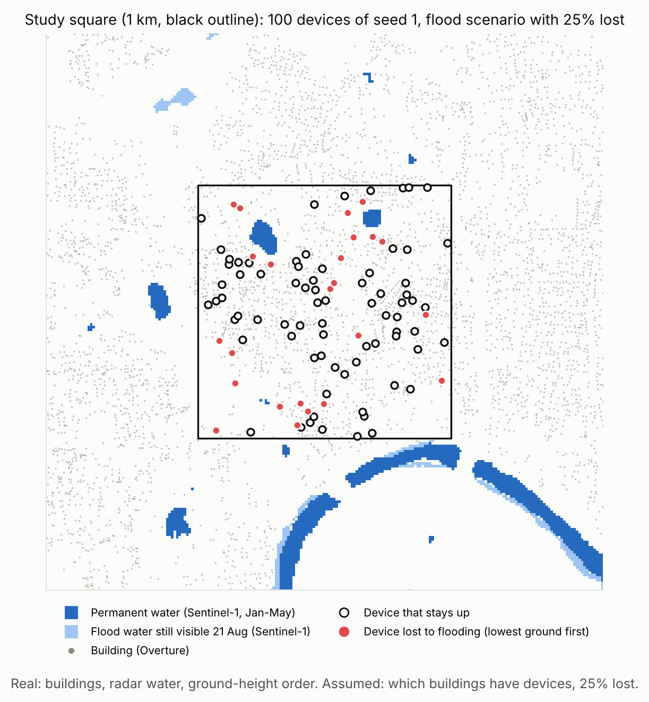

*Fig. 1: Chalakudy study square (1 km, black outline) with the 100 devices of seed 1 in the flood scenario with 25% lost. Real: building positions, radar water and the ground-height order. Assumed: which buildings have devices, and the 25% share. © OpenStreetMap contributors, Overture Maps Foundation; contains modified Copernicus Sentinel data 2018.*

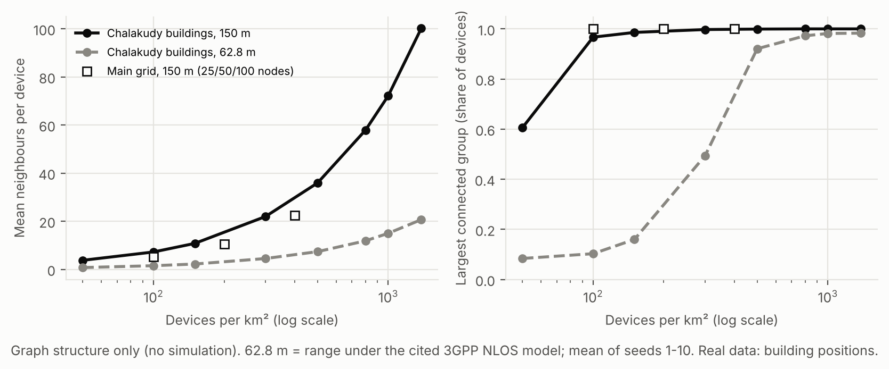

*Fig. 2: Network structure on the Chalakudy buildings (no simulation): mean neighbours per device and share of devices in the largest connected group, against device density, at 150 m and at the 62.8 m range of the cited path-loss model. Squares: the main grid. Mean of seeds 1–10.*

### G. Chalakudy Scenario: Failures, Batteries and Traffic

Each seed compares three failure models on the same devices and flows. In the flood-order model, 25% of devices fail (10% and 50% in a sweep), evenly spaced in time from the onset day to 18 Aug 00:00, lowest ground first; flooded devices do not return. Press reports disagree on the onset, 15 Aug [16] or 17 Aug [17], so both are run. The uniform-random model fails the same number of devices at the same times at random devices, and the no-flood control has no failures. The flood pattern is only moderately clustered: the nearest other failed device is 83 m away on average under the flood order and about 104 m under random failures.

Batteries are either unlimited, which isolates the effect of flooding, or limited. From the power cut, assumed at 00:00 on the onset day, each device has a random charge of 20–100% of an assumed 3,000 mAh, 3.85 V battery, of which 50% is available to the radio (25% and 100% in a sweep), time-compressed like the scenario; radio power uses ns-3's default currents. Traffic is 20 flows between devices of the same connected group at least two hops apart, sending bursts of 5 packets 0.2 s apart with exponential gaps (mean 15 s; 7.5 s and 30 s in a sweep). One day lasts 30 s, as in the Kerala-anchored model. Results are reported for three windows: before the onset, the acute phase (onset to 18 Aug) and the sustained phase (18–27 Aug).

### H. Propagation Sensitivity

To test the 150 m assumption, the chalakudy_prop experiment replaces the unit disk with the 3GPP TR 37.885 urban non-line-of-sight path-loss formula, PL = 36.85 + 30 log10(d) + 18.9 log10(f) [18], with f = 2.412 GHz, as implemented in ns-3.47 and without adjustment. With ns-3's default transmit power (16.02 dBm) and preamble-detection threshold (−82 dBm), frames get through up to 62.8 m (checked with two devices: all frames at 62.5 m, none at 63 m). The model assumes no line of sight on every link, and it was made for vehicles, not for devices inside houses.

### I. Statistics

Results are means over the 10 seeds with 95% confidence intervals (t-distribution). Because runs are paired, protocols are compared with a Friedman test over the three protocols [19], followed by two-sided Wilcoxon signed-rank tests for each pair [20] with Holm's correction over the three pairs [21]. Flood-order and uniform-random failures are compared with Wilcoxon tests for each protocol, Holm-corrected over the protocols. With 10 paired seeds the smallest possible Holm-corrected p value is 0.0059. The correction covers only the comparisons within one configuration and metric; across the hundreds of tests in this paper some p values below 0.05 are expected by chance, so a difference carries weight only when it holds across configurations.

### J. Validation

A four-node diamond topology was simulated first as a sanity check. Our packet tracker agrees exactly with ns-3's FlowMonitor in the Chalakudy cross-check runs, and our state-based energy count agrees with ns-3's energy framework when batteries are effectively unlimited. ns-3's energy framework did not drain finite batteries correctly (its radio model stopped counting at about 72% of the initial energy), so all battery-limited runs use the state-based model. At 100 or more nodes some OLSR packets exceeded the Wi-Fi MTU and were fragmented, which crashed or slightly miscounted the control-traffic counter; the counter was fixed and the 29 affected runs were redone. Every run's metrics recompute identically from its raw files, and the analysis reproduces byte for byte. On a second machine 467 of 482 replayed runs matched exactly; the other 15, all dense 100-node AODV runs, differ run by run but agree on average.

## V. Results

### A. Main Grid

Table VI and Fig. 3 give delivery within 1 s in the main grid. At 100 nodes AODV delivers 24–41 points less than OLSR in every scenario (59.4% against 99.9% in the baseline; Holm p = 0.0059 in all six scenarios), while DSDV stays within 3 points of OLSR. At 25 nodes AODV is slightly ahead of OLSR in the five failure scenarios (median paired difference 0.5–1.7 points, Holm p ≤ 0.016), and at 50 nodes AODV and OLSR differ by at most 1.1 points. The partition caps every protocol at 73–76% at 25 and 50 nodes, since packets between the two halves cannot be delivered while it lasts.

**TABLE VI: Delivered within T = 1 s (%) in the main grid, mean ± 95% CI over 10 seeds**

| Scenario | Nodes | AODV | OLSR | DSDV |
|---|---|---|---|---|
| Baseline | 25 | 100.0 ± 0.1 | 99.7 ± 0.4 | 99.1 ± 1.4 |
| Baseline | 50 | 98.9 ± 0.8 | 100.0 ± 0.0 | 99.4 ± 0.2 |
| Baseline | 100 | 59.4 ± 4.4 | 99.9 ± 0.1 | 97.3 ± 0.3 |
| Link failure | 25 | 83.6 ± 16.3 | 82.3 ± 15.9 | 82.1 ± 16.9 |
| Link failure | 50 | 98.5 ± 1.1 | 99.1 ± 0.3 | 99.2 ± 0.4 |
| Link failure | 100 | 58.9 ± 5.5 | 99.5 ± 0.2 | 97.3 ± 0.3 |
| Node failure | 25 | 91.0 ± 14.3 | 89.3 ± 13.7 | 87.5 ± 15.6 |
| Node failure | 50 | 97.0 ± 4.9 | 96.4 ± 4.8 | 95.0 ± 5.0 |
| Node failure | 100 | 74.7 ± 3.1 | 98.8 ± 0.2 | 97.5 ± 0.3 |
| Multiple failures | 25 | 91.1 ± 9.8 | 90.1 ± 9.4 | 89.6 ± 10.8 |
| Multiple failures | 50 | 98.5 ± 1.5 | 98.4 ± 0.6 | 98.4 ± 0.9 |
| Multiple failures | 100 | 65.6 ± 4.8 | 98.6 ± 0.3 | 97.9 ± 0.3 |
| Partition | 25 | 73.8 ± 4.2 | 73.3 ± 4.2 | 73.5 ± 4.5 |
| Partition | 50 | 75.1 ± 4.0 | 75.4 ± 3.9 | 76.1 ± 3.9 |
| Partition | 100 | 49.0 ± 5.7 | 74.0 ± 5.9 | 72.6 ± 5.2 |
| Recovery | 25 | 95.0 ± 7.8 | 92.9 ± 7.9 | 91.6 ± 9.4 |
| Recovery | 50 | 97.8 ± 2.7 | 97.2 ± 2.8 | 96.4 ± 3.1 |
| Recovery | 100 | 67.8 ± 3.5 | 98.8 ± 0.2 | 97.2 ± 0.4 |

Table VII shows what changes at 100 nodes in the baseline. AODV's PDR falls to 60.0%, its median delay rises to 17.5 ms against 2.1 ms for OLSR, and it sends 18.65 control packets per node per second against 0.75 for OLSR. The MAC reports 14,943 link breaks (unicast frames dropped after the retry limit) per AODV run, against 2.4 for OLSR and 138.5 for DSDV, and AODV's median route discovery takes 77.6 ms. With RTS/CTS switched on, AODV delivers 46.7% within 1 s, OLSR 99.9% and DSDV 97.1%.

**TABLE VII: Baseline scenario of the main grid: delivery, delay and control traffic (mean ± 95% CI)**

| Metric | Nodes | AODV | OLSR | DSDV |
|---|---|---|---|---|
| PDR (%) | 25 | 100.0 ± 0.0 | 99.7 ± 0.4 | 99.1 ± 1.4 |
| PDR (%) | 50 | 98.9 ± 0.8 | 100.0 ± 0.0 | 99.4 ± 0.2 |
| PDR (%) | 100 | 60.0 ± 4.4 | 99.9 ± 0.1 | 97.3 ± 0.3 |
| Median delay (ms) | 25 | 3.0 ± 0.8 | 2.8 ± 0.7 | 3.0 ± 0.8 |
| Median delay (ms) | 50 | 2.8 ± 0.3 | 2.7 ± 0.3 | 2.8 ± 0.3 |
| Median delay (ms) | 100 | 17.5 ± 7.0 | 2.1 ± 0.3 | 2.6 ± 0.2 |
| Control pkts/node/s | 25 | 1.13 ± 0.07 | 0.72 ± 0.03 | 1.39 ± 0.08 |
| Control pkts/node/s | 50 | 2.52 ± 0.71 | 0.74 ± 0.01 | 3.17 ± 0.08 |
| Control pkts/node/s | 100 | 18.65 ± 1.46 | 0.75 ± 0.02 | 6.84 ± 0.03 |
| MAC link breaks/run | 100 | 14,943 | 2.4 | 138.5 |

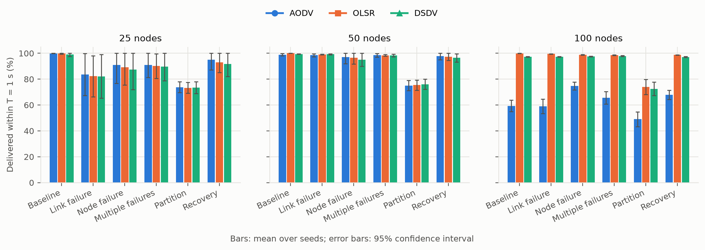

*Fig. 3: Delivered within T = 1 s in the main grid, by failure scenario and network size. Bars: mean over seeds 1–10; error bars: 95% confidence interval.*

### B. Severity and Load

Random failures of 5–30% of relay nodes or links at 50 nodes leave every protocol at 98.2–99.9% delivery within 1 s (Table VIII). With more flows, AODV's delivery within 1 s in the baseline falls from 99.7% with 5 flows to 96.2% with 20, while OLSR stays at 100.0% and DSDV at 99.4–99.5% (Table IX).

**TABLE VIII: Delivered within 1 s (%) under random failures, 50 nodes**

| Failures | Share failed | AODV | OLSR | DSDV |
|---|---|---|---|---|
| Random links | 5% | 99.0 ± 0.8 | 99.6 ± 0.2 | 99.4 ± 0.2 |
| Random links | 10% | 99.2 ± 0.5 | 99.6 ± 0.1 | 99.3 ± 0.2 |
| Random links | 20% | 99.3 ± 0.6 | 99.1 ± 0.3 | 99.6 ± 0.2 |
| Random links | 30% | 98.7 ± 1.7 | 98.7 ± 0.2 | 99.3 ± 0.3 |
| Random relay nodes | 5% | 99.2 ± 0.6 | 99.9 ± 0.1 | 99.3 ± 0.3 |
| Random relay nodes | 10% | 99.4 ± 0.6 | 99.6 ± 0.2 | 99.2 ± 0.2 |
| Random relay nodes | 20% | 99.5 ± 0.4 | 99.1 ± 0.4 | 99.0 ± 0.5 |
| Random relay nodes | 30% | 99.6 ± 0.3 | 98.8 ± 0.4 | 98.2 ± 1.6 |

**TABLE IX: Delivered within 1 s (%) by number of flows, 50 nodes**

| Scenario | Flows | AODV | OLSR | DSDV |
|---|---|---|---|---|
| Baseline | 5 | 99.7 ± 0.2 | 100.0 ± 0.0 | 99.5 ± 0.3 |
| Baseline | 10 | 98.9 ± 0.8 | 100.0 ± 0.0 | 99.4 ± 0.2 |
| Baseline | 20 | 96.2 ± 3.1 | 100.0 ± 0.0 | 99.4 ± 0.1 |
| Node failure | 5 | 99.7 ± 0.2 | 98.1 ± 0.5 | 97.5 ± 1.7 |
| Node failure | 10 | 97.0 ± 4.9 | 96.4 ± 4.8 | 95.0 ± 5.0 |
| Node failure | 20 | 97.4 ± 2.1 | 97.9 ± 1.7 | 97.7 ± 2.2 |

### C. Energy

With ns-3's default radio the first node runs flat at about 205 s and half of the nodes at about 400 s under every protocol (Table X, Fig. 4), with no significant difference between protocols in the time of the first depletion. OLSR sends the fewest control packets (0.49 per node per second, against 1.75 for AODV and 1.86 for DSDV). With the low-idle radio the first node runs flat at 165.2 s under AODV, 157.8 s under OLSR and 154.4 s under DSDV (paired medians: AODV later than OLSR by 6 s, Holm p = 0.012; OLSR later than DSDV by 4 s, p = 0.043).

**TABLE X: Energy experiment, 50 nodes: time until nodes run flat and control traffic**

| Radio | Protocol | First node flat (s) | Half of nodes flat (s) | Control pkts/node/s |
|---|---|---|---|---|
| Default | AODV | 205.3 ± 3.1 | 400.1 ± 13.1 | 1.75 ± 0.41 |
| Default | DSDV | 205.0 ± 3.3 | 399.0 ± 13.1 | 1.86 ± 0.08 |
| Default | OLSR | 205.2 ± 3.2 | 400.1 ± 13.2 | 0.49 ± 0.01 |
| Low-idle radio | AODV | 165.2 ± 7.6 | 335.3 ± 10.0 | 1.36 ± 0.28 |
| Low-idle radio | DSDV | 154.4 ± 5.9 | 312.0 ± 8.6 | 1.46 ± 0.05 |
| Low-idle radio | OLSR | 157.8 ± 7.3 | 330.1 ± 10.3 | 0.41 ± 0.01 |

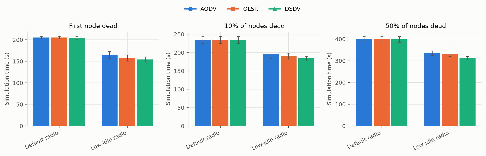

*Fig. 4: Energy experiment (50 nodes): simulation time until the first node, 10% of nodes and 50% of nodes run flat, with ns-3's default radio and a low-idle radio. Error bars: 95% confidence interval.*

### D. Kerala-Anchored Scenario

Tables XI and XII and Figs. 5 and 6 give delivery within 1 s in the two phases. Without flooding OLSR already delivers more than AODV in the acute phase: 99.9% against 96.4% at 50 nodes and 100.0% against 76.0% at 100 nodes. At 100 nodes OLSR stays ahead of AODV in every flood scenario of the acute phase, by 8.5–15.7 points (Holm p = 0.0059 in each), a smaller gap than in the no-flood control (24.0 points). At 50 nodes the flood scenarios bring all three protocols to 69–88%, and AODV and OLSR differ by at most 1.8 points: OLSR is ahead under Kerala-anchored 27% failures (median 1.3 points, p = 0.029) and AODV under random 50% failures (1.2 points, p = 0.037). Counting only packets sent while a path existed, OLSR delivers 94.5–99.5% in the acute phase at 100 nodes and AODV 80.2–82.9%.

**TABLE XI: Kerala-anchored scenario, acute phase, 14–18 Aug: delivered within 1 s (%)**

| Nodes | Scenario | AODV | OLSR | DSDV |
|---|---|---|---|---|
| 50 | No flooding | 96.4 ± 1.2 | 99.9 ± 0.1 | 99.6 ± 0.2 |
| 50 | Kerala-anchored 27% | 80.9 ± 5.8 | 82.7 ± 5.6 | 81.8 ± 6.1 |
| 50 | Random 27% | 87.2 ± 2.6 | 87.7 ± 3.0 | 82.6 ± 4.6 |
| 50 | Kerala-anchored 50% | 71.8 ± 6.9 | 72.2 ± 6.8 | 69.3 ± 7.2 |
| 50 | Random 50% | 74.2 ± 7.2 | 73.0 ± 6.8 | 69.1 ± 5.7 |
| 100 | No flooding | 76.0 ± 3.7 | 100.0 ± 0.0 | 97.5 ± 0.6 |
| 100 | Kerala-anchored 27% | 65.4 ± 4.5 | 81.1 ± 4.3 | 78.4 ± 4.6 |
| 100 | Random 27% | 71.0 ± 5.0 | 84.6 ± 5.0 | 81.8 ± 4.6 |
| 100 | Kerala-anchored 50% | 60.5 ± 4.2 | 73.3 ± 3.3 | 70.3 ± 3.5 |
| 100 | Random 50% | 61.7 ± 6.9 | 70.2 ± 5.5 | 68.0 ± 5.7 |

In the sustained phase, with the flooded nodes gone and batteries running out, delivery within 1 s in the flood scenarios is 26–58% at 50 nodes and 33–60% at 100 nodes. At 50 nodes AODV and OLSR do not differ significantly in any scenario. At 100 nodes OLSR stays ahead in four of the five scenarios (median 1.6–10.6 points, Holm p ≤ 0.012); under random 50% failures the 1.2-point difference is not significant.

**TABLE XII: Kerala-anchored scenario, sustained phase, 18–27 Aug: delivered within 1 s (%)**

| Nodes | Scenario | AODV | OLSR | DSDV |
|---|---|---|---|---|
| 50 | No flooding | 79.1 ± 4.6 | 80.2 ± 4.8 | 78.7 ± 5.1 |
| 50 | Kerala-anchored 27% | 50.6 ± 6.4 | 50.9 ± 6.5 | 49.0 ± 5.3 |
| 50 | Random 27% | 58.1 ± 9.3 | 58.3 ± 9.3 | 57.3 ± 9.9 |
| 50 | Kerala-anchored 50% | 31.5 ± 10.8 | 31.4 ± 10.9 | 30.7 ± 10.5 |
| 50 | Random 50% | 26.0 ± 8.7 | 26.3 ± 8.7 | 25.5 ± 8.2 |
| 100 | No flooding | 71.3 ± 3.7 | 81.2 ± 4.3 | 78.7 ± 3.9 |
| 100 | Kerala-anchored 27% | 50.6 ± 6.7 | 54.3 ± 7.3 | 52.0 ± 6.5 |
| 100 | Random 27% | 57.1 ± 7.1 | 60.2 ± 7.7 | 57.5 ± 7.5 |
| 100 | Kerala-anchored 50% | 33.3 ± 7.8 | 35.2 ± 8.1 | 34.3 ± 8.0 |
| 100 | Random 50% | 36.6 ± 11.4 | 37.7 ± 11.1 | 36.8 ± 10.9 |

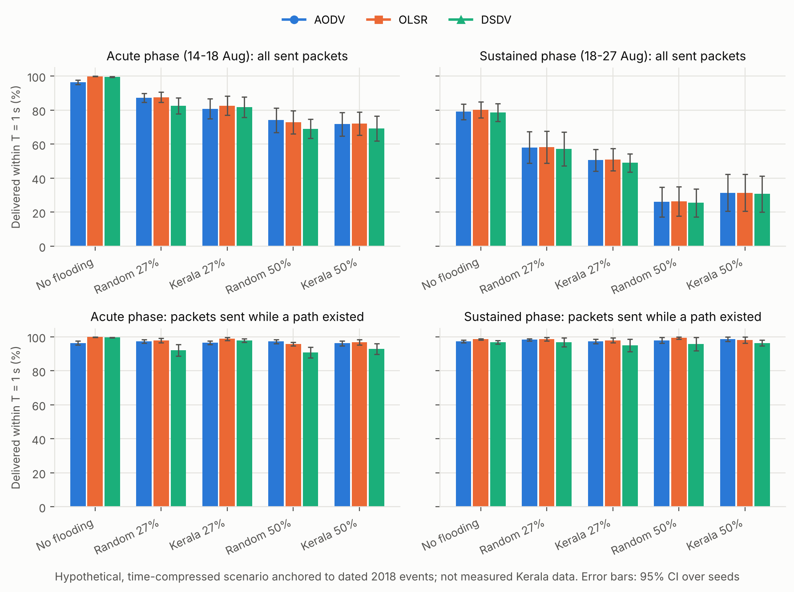

*Fig. 5: Kerala-anchored scenario, 50 nodes: delivered within 1 s in the acute (14–18 Aug) and sustained (18–27 Aug) phases, for all sent packets (top) and for packets sent while a path existed (bottom). A hypothetical, time-compressed scenario anchored to dated 2018 events, not measured Kerala data.*

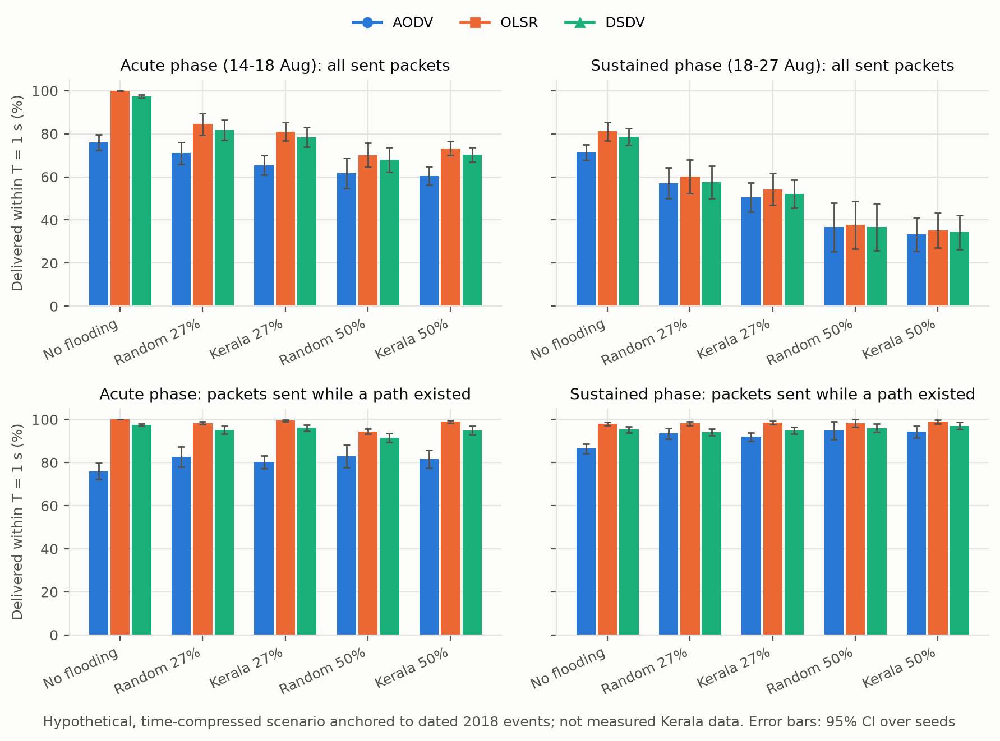

*Fig. 6: Kerala-anchored scenario, 100 nodes, as in Fig. 5.*

### E. Chalakudy Scenario

Table XIII and Fig. 7 give delivery within 1 s on the Chalakudy building topology with unlimited batteries. Without flooding OLSR delivers 100% in every window, DSDV 95.4–97.7% and AODV 86.2–91.2% (AODV below OLSR by a median of 9.0–9.7 points in the acute and sustained phases, Holm p = 0.0059). This gap grows with the time between bursts, to about 4, 9 and 12–15 points at mean gaps of 7.5, 15 and 30 s, and so do AODV's route discoveries per burst (1.6, 2.3 and 3.0), while AODV's PDR stays at 97–98%.

**TABLE XIII: Chalakudy scenario, onset 15 Aug, 25% flooded, no battery limit: delivered within 1 s (%)**

| Window | Scenario | AODV | OLSR | DSDV |
|---|---|---|---|---|
| Before onset | all | 86.2 ± 3.4 | 100.0 ± 0.0 | 95.4 ± 3.2 |
| Acute | No flooding | 91.2 ± 1.1 | 100.0 ± 0.0 | 97.3 ± 2.0 |
| Acute | Flood order | 72.3 ± 6.4 | 75.8 ± 6.5 | 70.2 ± 5.5 |
| Acute | Uniform random | 75.9 ± 6.3 | 75.9 ± 8.1 | 65.8 ± 7.1 |
| Acute, path existed | No flooding | 91.2 ± 1.1 | 100.0 ± 0.0 | 97.3 ± 2.0 |
| Acute, path existed | Flood order | 89.8 ± 3.9 | 94.1 ± 2.5 | 87.4 ± 4.1 |
| Acute, path existed | Uniform random | 89.3 ± 2.2 | 89.0 ± 3.0 | 77.4 ± 4.7 |
| Sustained | No flooding | 90.4 ± 1.7 | 100.0 ± 0.0 | 97.7 ± 0.9 |
| Sustained | Flood order | 50.9 ± 12.1 | 56.8 ± 13.5 | 53.9 ± 13.5 |
| Sustained | Uniform random | 52.2 ± 15.9 | 59.5 ± 18.0 | 56.6 ± 17.2 |
| Sustained, path existed | No flooding | 90.4 ± 1.7 | 100.0 ± 0.0 | 97.7 ± 0.9 |
| Sustained, path existed | Flood order | 89.7 ± 3.0 | 100.0 ± 0.0 | 93.5 ± 4.5 |
| Sustained, path existed | Uniform random | 85.6 ± 6.9 | 99.9 ± 0.1 | 95.1 ± 2.0 |

With 25% of devices flooded, delivery within 1 s in the acute phase falls to 75.8% for OLSR, 72.3% for AODV and 70.2% for DSDV under the flood order, and to 75.9%, 75.9% and 65.8% under random failures; OLSR and AODV do not differ significantly here. Across the 12 flooded configurations without battery limits (both failure models, the share sweep and the traffic sweep), OLSR is significantly ahead of AODV in 4, at 10% flooded and with 30 s between bursts, and never behind (Table XIV, Fig. 10). At 50% flooded AODV and OLSR are level at about 57%. Counting only packets sent while a path existed, the protocols deliver 77–94% in the acute phase and 86–100% in the sustained phase (Fig. 8), so most of the loss after the onset falls on devices that were flooded or cut off. In the sustained phase all protocols deliver 51–60% within 1 s, with OLSR above AODV by a median of 5.5–6.9 points (Holm p = 0.0059), about the same gap as without flooding (Fig. 9).

**TABLE XIV: Chalakudy, acute phase, onset 15 Aug, no battery limit: delivered within 1 s (%) as one setting changes (main: 25% flooded, 15 s gap)**

| Setting | Failures | AODV | OLSR | DSDV |
|---|---|---|---|---|
| 10% flooded | Flood order | 86.6 ± 3.2 | 93.6 ± 2.3 | 87.6 ± 5.8 |
| 25% flooded (main) | Flood order | 72.3 ± 6.4 | 75.8 ± 6.5 | 70.2 ± 5.5 |
| 50% flooded | Flood order | 57.5 ± 7.5 | 57.0 ± 8.2 | 49.2 ± 6.5 |
| gap 7.5 s | Flood order | 75.5 ± 5.3 | 76.8 ± 5.3 | 68.6 ± 6.2 |
| gap 30 s | Flood order | 67.0 ± 8.2 | 74.6 ± 7.3 | 70.4 ± 10.9 |
| 10% flooded | Uniform | 82.8 ± 5.0 | 89.3 ± 5.0 | 83.6 ± 5.2 |
| 25% flooded (main) | Uniform | 75.9 ± 6.3 | 75.9 ± 8.1 | 65.8 ± 7.1 |
| 50% flooded | Uniform | 58.8 ± 7.9 | 56.1 ± 8.6 | 47.0 ± 7.8 |
| gap 7.5 s | Uniform | 75.9 ± 6.5 | 74.9 ± 6.6 | 64.0 ± 8.8 |
| gap 30 s | Uniform | 66.7 ± 6.8 | 75.1 ± 7.2 | 64.4 ± 10.0 |

Flood order against random failures. Failures ordered by real ground height and failures at random devices show no significant difference in delivery within 1 s in any of 87 comparisons (every protocol, window, onset, share, battery and traffic setting; smallest Holm p = 0.15). Counting only packets sent while a path existed, 2 of 78 comparisons reach p < 0.05, both in favour of the flood order in the acute phase (DSDV at 25% and OLSR at 50% flooded).

Batteries. With the assumed batteries and ns-3's radio currents, the last device runs flat 4, 7 and 14 hours of scenario time after the power cut when 25%, 50% and 100% of the battery is available to the radio, at the same time under every protocol, so nothing is sent in the sustained phase. Counted against every scheduled message, battery-limited runs deliver only 6–26%.

Propagation. Under the 3GPP path-loss model no packet was delivered in any of the 90 runs (184,731 sent): at a range of 62.8 m, 100 devices in the square do not form a network. All other results assume the 150 m unit disk.

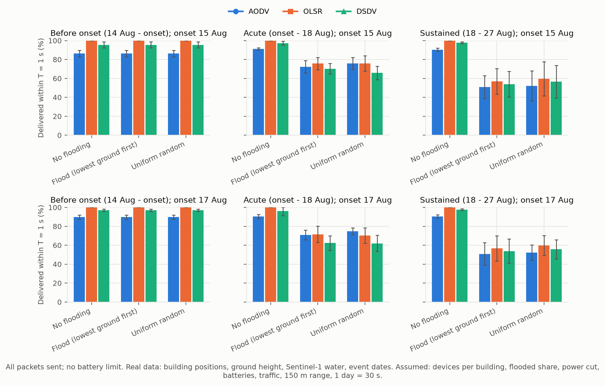

*Fig. 7: Chalakudy scenario: delivered within 1 s by window, onset 15 Aug (top) or 17 Aug (bottom), 25% flooded, no battery limit. Real data: building positions, ground height, Sentinel-1 water, event dates. Assumed: devices per building, flooded share, power cut, batteries, traffic, 150 m range, 1 day = 30 s.*

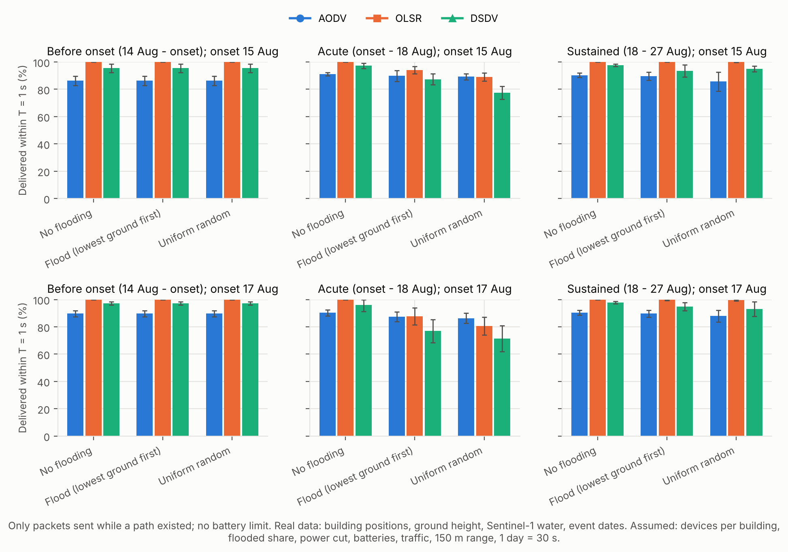

*Fig. 8: Chalakudy scenario as in Fig. 7, counting only packets sent while a path existed between source and destination.*

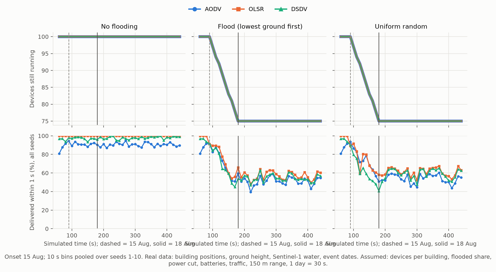

*Fig. 9: Chalakudy scenario over time, onset 15 Aug, no battery limit: devices still running (top) and delivered within 1 s in 10 s bins pooled over seeds 1–10 (bottom). Dashed line: 15 Aug; solid line: 18 Aug.*

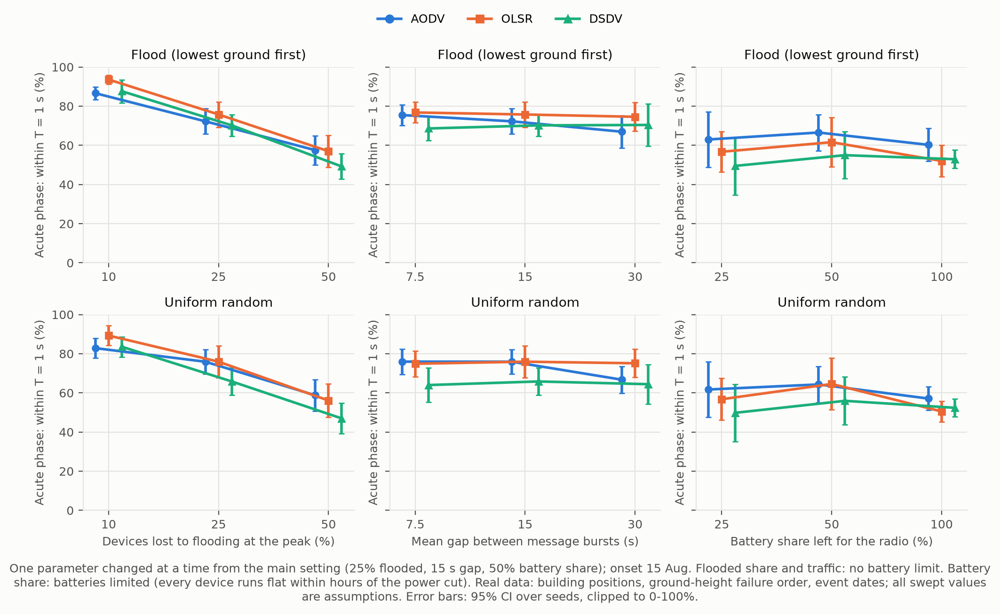

*Fig. 10: Chalakudy, acute phase, onset 15 Aug: delivered within 1 s as one setting changes from the main setting (25% flooded, 15 s gap, 50% battery share). Flooded share and traffic: no battery limit; battery share: batteries limited. All swept values are assumptions.*

## VI. Discussion

[Your text. Does the evidence support each half of the premise? Separate what the topology and traffic do (visible in the no-flood controls) from what flooding does. What can the battery results say about the sustained phase, given that every device ran flat within hours under every protocol? How much do the results depend on the 150 m range?]

## VII. Limitations

Radio and network. Radio propagation is a 150 m unit disk; under a cited path-loss model the default radio reaches 62.8 m, and 100 devices in the Chalakudy square do not form a network. Devices are static, RTS/CTS is off, and all protocols use ns-3's default parameters.

Traffic. No data exist on message traffic during the floods, so all traffic is assumed: constant-rate flows in the main grid and bursts in the flood scenarios.

Energy. Only the Wi-Fi radio uses energy, with ns-3's default currents rather than those of a real 2018 device, and the battery size is a placeholder. With these values every device runs flat within hours of the power cut.

Time compression. One day lasts 30 simulated seconds for failures and batteries, but routing timers and traffic are not compressed.

Kerala-anchored model. Positions and terrain are synthetic, the flood curve and flooded shares are assumed, and the 27% figure comes from a press report.

Chalakudy data. Radar cannot see which buildings flooded and missed the flood peak; ground height comes from a surface model that includes roofs and trees; the square is nearly flat; the buildings are present-day map features, not the 2018 town; only one 1 km square is studied; and the flooded share, the number of devices per building and the power-cut date are assumed. The two onset dates come from press reports that disagree.

Statistics. With hundreds of tests, some p values below 0.05 are expected by chance.

Predictions. Predictions were not written down before the runs, so no result is a blind test of the premise.

## VIII. Conclusion

[Your text: answer the research question in two or three sentences, then the main caveat and what you would do next.]

## Acknowledgment

Building data © OpenStreetMap contributors and Overture Maps Foundation (ODbL). Municipality boundary: DataMeet (ODbL). Machine-detected building footprints: Google Open Buildings [VERIFY licence wording]. Contains modified Copernicus Sentinel data 2018. Copernicus DEM [VERIFY attribution wording on the Copernicus licence page]. [Thank anyone who helped.]

## Data Availability

Code, inputs, raw simulation outputs and analysis are in the public repository [7]. Raw downloads (about 170 MB) are re-fetched by experiments/chalakudy_fetch.py, which records the URL, access time and SHA-256 of each file. The tables of this paper are in docs/paper/tables of the repository and in Google Sheets: main grid, severity and load, energy, Kerala-anchored scenario, Chalakudy windows and Chalakudy sweeps (folder); docs/paper/tests.csv lists every paired test. [Before submission: add an ODbL notice for the derived data and a licence for the code; the repository has none.]

## References

[1] Comptroller and Auditor General of India, Report No. 6 of 2021 (Kerala floods), ch. III and sec. 3.5.2. [Online]. Available: https://cag.gov.in/ag1/kerala/en/audit-report/details/114526

[2] TelecomTalk (reporting The Economic Times), report on the Telecom Secretary's review of network damage in Kerala, 27 Aug. 2018. [Online]. Available: https://telecomtalk.info/?p=180759 (press report).

[3] C. Perkins, E. Belding-Royer, and S. Das, "Ad hoc On-Demand Distance Vector (AODV) routing," RFC 3561, 2003. [VERIFY]

[4] T. Clausen and P. Jacquet, "Optimized Link State Routing Protocol (OLSR)," RFC 3626, 2003. [VERIFY]

[5] C. E. Perkins and P. Bhagwat, "Highly dynamic destination-sequenced distance-vector routing (DSDV) for mobile computers," in Proc. ACM SIGCOMM, 1994. [VERIFY]

[6] ns-3 network simulator, version 3.47. [Online]. Available: https://www.nsnam.org

[7] Kerala mesh simulation: code, inputs, raw outputs and analysis. [Online]. Available: https://github.com/unknownsoldier1bit/kerala-mesh-simulation (branch chalakudy-buildings).

[8] Kerala State Electricity Board, How KSEBL survived flood 2018. [NEEDS URL; check which area the 27 Aug date covers]

[9] Overture Maps Foundation, release 2026-10-21.0. [Online]. Available: https://overturemaps.org (accessed 29 Oct. 2026).

[10] OpenStreetMap contributors. [Online]. Available: https://www.openstreetmap.org (via Overture Maps).

[11] W. Sirko et al., "Continental-scale building detection from high resolution satellite imagery," arXiv:2107.12283, 2021. [VERIFY]

[12] DataMeet, Indian Village Boundaries: Kerala. [Online]. Available: https://github.com/datameet/indian_village_boundaries (accessed 29 Oct. 2026).

[13] European Space Agency, Copernicus DEM GLO-30, doi: 10.5270/ESA-c5d3d65. [VERIFY]

[14] European Space Agency, Copernicus Sentinel-1 GRD data, 2018 (AWS Open Data, sentinel-s1-l1c; accessed 29 Oct. 2026).

[15] N. Otsu, "A threshold selection method from gray-level histograms," IEEE Trans. Syst., Man, Cybern., vol. 9, no. 1, pp. 62–66, 1979. [VERIFY]

[16] Deccan Herald, article reporting that Chalakudy flooded early on 15 Aug. 2018. [NEEDS URL]

[17] Scroll, article quoting a Member of Parliament that Chalakudy flooded on 17 Aug. 2018. [NEEDS URL]

[18] 3GPP, "Study on evaluation methodology of new Vehicle-to-Everything (V2X) use cases for LTE and NR," TR 37.885 V15.3.0, Jun. 2019, Table 6.2.1-1. [VERIFY]

[19] M. Friedman, "The use of ranks to avoid the assumption of normality implicit in the analysis of variance," J. Amer. Statist. Assoc., vol. 32, no. 200, pp. 675–701, 1937. [VERIFY]

[20] F. Wilcoxon, "Individual comparisons by ranking methods," Biometrics Bull., vol. 1, no. 6, pp. 80–83, 1945. [VERIFY]

[21] S. Holm, "A simple sequentially rejective multiple test procedure," Scand. J. Statist., vol. 6, no. 2, pp. 65–70, 1979. [VERIFY]

[22] Government of Kerala, Additional Memorandum, 13 Sep. 2018, Table 3, pp. 11–12. [Online]. Available: https://recovery.preventionweb.net/media/101476/download

## Appendix A: Chalakudy Parameters

Table XV condenses data/chalakudy/PROVENANCE.md, which gives all 43 parameters with their sources and reasoning.

**TABLE XV: Chalakudy parameters: measured, derived or assumed (condensed from data/chalakudy/PROVENANCE.md)**

| Parameter | Value | Kind | Swept |
|---|---|---|---|
| Study area | 1 km square, lowest-lying built-up area | Assumed rule | alternative square recorded |
| Devices | 100, one per random building | Assumed | network structure only (50–1,000) |
| Ground estimate | 5th percentile of DEM within 50 m | Derived | - |
| Flooded share at peak | 25% | Assumed | 10%, 25%, 50% |
| Onset | 15 Aug (sources disagree) | Measured (press) | 15, 17 Aug |
| Peak | 18 Aug 00:00 | Assumed from dated events | - |
| Flooded devices return | no | Assumed | - |
| Power cut | 00:00 on the onset day | Assumed (KSEB date not found) | - |
| Power back / end of run | 27 Aug | Measured (KSEB, NEEDS URL) | - |
| Battery | 3,000 mAh, 3.85 V (placeholder) | Assumed | - |
| Battery share for the radio | 50% | Assumed | 25%, 50%, 100% |
| Charge at the power cut | uniform 20–100% | Assumed | - |
| Radio energy model | ns-3 defaults (0.82 W idle) | Assumed (values from ns-3) | - |
| Time compression | 1 day = 30 s | Assumed | - |
| Traffic | 20 flows, bursts of 5 packets, mean gap 15 s | Assumed | 7.5, 15, 30 s |
| Radio range | 150 m unit disk | Assumed | cited path-loss model (62.8 m) |
| Geoid offset | −96 m (EGM2008 check: −95.7 m) | Derived | - |
| Water threshold | Otsu per scene, −12.9 to −10.6 dB | Derived | - |
| Minimum flood patch | 10 cells (0.1 ha) | Assumed | - |

## Appendix B: Sentinel-1 Scenes

Reference water detected is the share of cells inside mapped rivers and ponds that are classified as water; far land as water is the share of land at least 150 m from mapped water that is classified as water, which bounds false detections in dry scenes (on 16 Jul, 9 Aug and 21 Aug part of it may be real flooding). Fig. 11 checks where the radar maps are placed.

**TABLE XVI: Sentinel-1 scenes over Chalakudy (dates as month/day)**

| Date (2018) | Time (UTC) | Satellite | Pass, orbit | Threshold (dB) | Water (%) | Reference water detected (%) | Far land as water (%) |
|---|---|---|---|---|---|---|---|
| 01/05 | 00:40 | S1A | descending 165 | −12.6 | 2.0 | 84.2 | 0.77 |
| 01/17 | 00:40 | S1A | descending 165 | −12.7 | 1.8 | 82.2 | 0.55 |
| 01/29 | 00:40 | S1A | descending 165 | −12.5 | 1.9 | 82.1 | 0.74 |
| 02/10 | 00:40 | S1A | descending 165 | −12.8 | 2.0 | 82.0 | 0.72 |
| 02/22 | 00:40 | S1A | descending 165 | −12.6 | 2.4 | 83.1 | 1.16 |
| 03/06 | 00:40 | S1A | descending 165 | −12.5 | 2.6 | 82.9 | 1.41 |
| 03/18 | 00:40 | S1A | descending 165 | −12.6 | 2.8 | 83.5 | 1.42 |
| 03/30 | 00:40 | S1A | descending 165 | −12.6 | 2.5 | 82.8 | 1.32 |
| 04/11 | 00:40 | S1A | descending 165 | −12.6 | 2.1 | 82.5 | 1.13 |
| 04/23 | 00:40 | S1A | descending 165 | −12.4 | 2.0 | 83.9 | 0.77 |
| 05/05 | 00:40 | S1A | descending 165 | −12.4 | 1.8 | 82.9 | 0.60 |
| 05/17 | 00:40 | S1A | descending 165 | −12.2 | 2.0 | 83.5 | 0.72 |
| 05/29 | 00:40 | S1A | descending 165 | −11.7 | 1.8 | 84.7 | 0.33 |
| 07/04 | 00:40 | S1A | descending 165 | −11.8 | 1.9 | 85.8 | 0.43 |
| 07/16 | 00:40 | S1A | descending 165 | −10.6 | 6.3 | 92.6 | 4.46 |
| 07/28 | 00:40 | S1A | descending 165 | −12.4 | 1.9 | 87.5 | 0.50 |
| 08/09 | 00:40 | S1A | descending 165 | −12.4 | 5.0 | 90.2 | 3.42 |
| 08/21 | 00:40 | S1A | descending 165 | −12.2 | 5.0 | 91.0 | 3.19 |
| 08/21 | 13:06 | S1A | ascending 173 | −12.9 | 4.2 | 85.1 | 2.56 |
| 08/27 | 00:40 | S1B | descending 165 | −12.3 | 2.7 | 68.3 | 1.45 |
| 08/27 | 13:05 | S1B | ascending 173 | −12.9 | 2.5 | 82.2 | 1.28 |
| 09/02 | 00:40 | S1A | descending 165 | −12.4 | 2.6 | 90.6 | 1.34 |
| 09/14 | 00:40 | S1A | descending 165 | −12.8 | 2.5 | 89.6 | 0.98 |
| 09/26 | 00:40 | S1A | descending 165 | −12.8 | 2.2 | 89.8 | 0.69 |

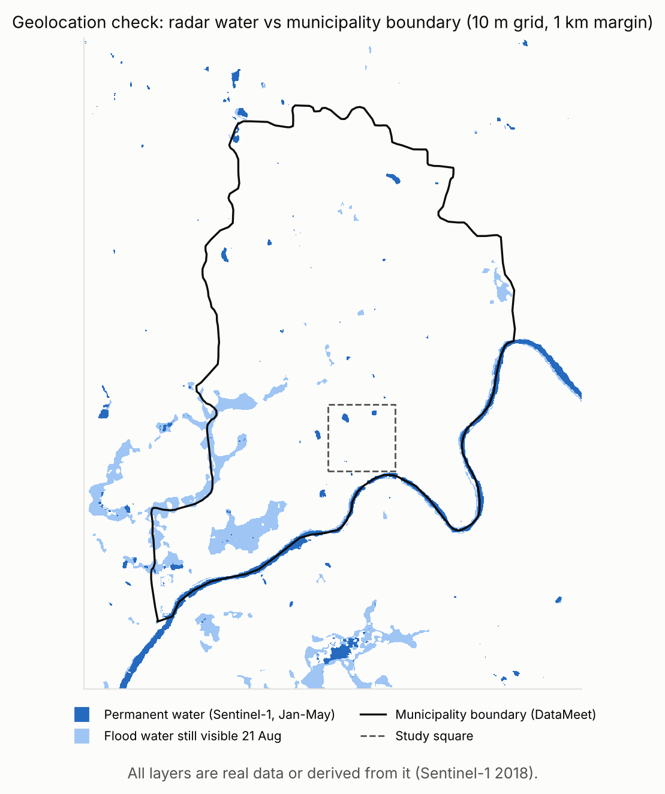

*Fig. 11: Geolocation check of the radar maps: permanent water and flood water still visible on 21 Aug against the municipality boundary (DataMeet) and the study square. The river on the radar maps follows the municipality's southern boundary. Contains modified Copernicus Sentinel data 2018.*

## Appendix C: Timeline

**TABLE XVII: Dated 2018 events used by the flood scenarios**

| Date (2018) | Event | Used as | Source |
|---|---|---|---|
| 14–18 Aug | Dam releases (Idukki shutters opened 10 Aug) | Water rises until 18 Aug 00:00 | CAG Report No. 6 of 2021, ch. III [1] |
| 15–17 Aug | IMD red alert for heavy rain, Thrissur | Same | Kerala Additional Memorandum, Table 3 [22] |
| 15 or 17 Aug | Chalakudy floods | Onset (both are run) | Deccan Herald [16]; Scroll [17] |
| 16 Aug | Communications fail in Chalakudy and Idukki taluks | Context | CAG sec. 3.5.2 [1] |
| 27 Aug | Last Thrissur substation back on | End of run | KSEB [8] |

